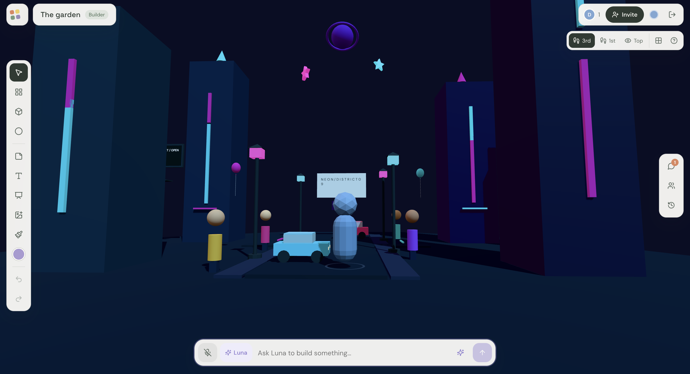
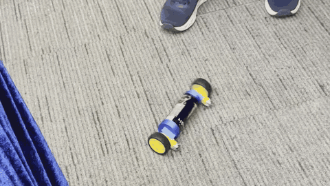
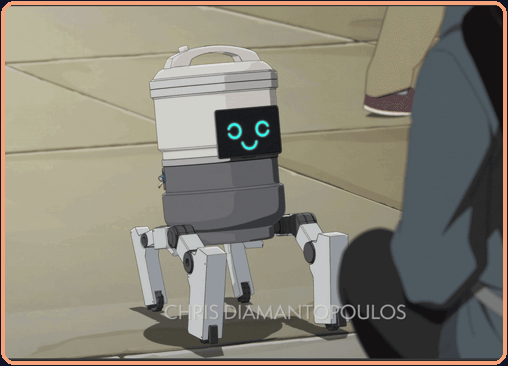
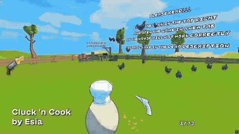
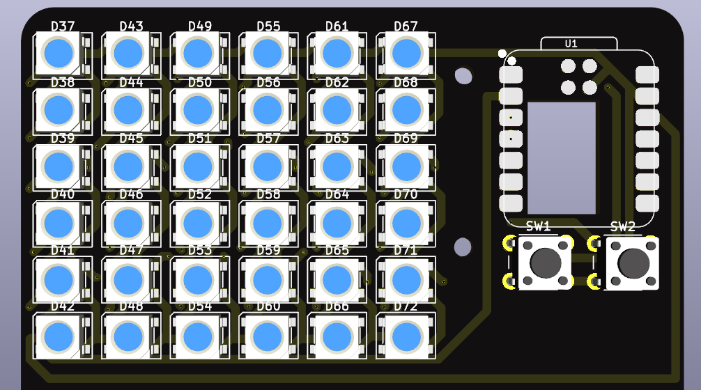
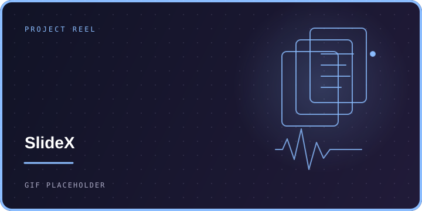

### I build tools that give ideas room to grow.

I’m **Esia** — exploring the space where thoughtful software, creative technology, and human connection meet.

&nbsp; 

---

## Project reel

<table>
  <tr>
    <td colspan="2" width="50%"></td>
    <td width="25%"></td>
    <td width="25%"></td>
  </tr>
  <tr>
    <td width="25%"></td>
    <td colspan="2" width="50%"></td>
    <td width="25%"></td>
  </tr>
  <tr>
    <td colspan="2" width="50%"></td>
    <td colspan="2" width="50%"></td>
  </tr>
</table>

Project tiles marked “GIF PLACEHOLDER” are ready for real clips as you capture them.

---

## What I’m making

### ◉  · spatial conversations

A shared 3D world where friends talk, explore as avatars, and shape rooms together with Luna, the built-in AI assistant.

`React Three Fiber` &nbsp; `TypeScript` &nbsp; `Rapier` &nbsp; `Node.js` &nbsp; `PostgreSQL`

## Selected projects

<!-- Add a project by duplicating a row. Keep the description to one clear sentence. -->

| Project | What it does | Built with |
|:--|:--|:--|
|  ⭐⭐⭐ | A shared 3D world where people talk, explore, and create with an AI assistant. | `React Three Fiber` · `TypeScript` · `Rapier` |
|  ⭐⭐⭐ | Builds and updates slide decks live from speech, with a browser display. | `Python` · `OpenAI Realtime API` · `ESP32` |
|  ⭐⭐⭐⭐⭐ | A rice-cooker robot with legs, documented with build notes and a hackathon zine. | `Go` · `Raspberry Pi` |
|  ⭐⭐⭐⭐ | A wave-based cartoon action shooter made for the Shiba Arcade game jam. | `Godot` · `GDScript` |
|  ⭐⭐⭐ | A hackathon badge prototype with 36 NeoPixels, two buttons, and a custom PCB. | `ESP32-C3` · `NeoPixel` · `KiCad` |
|  ⭐ <a href="https://github.com/flushloll/Daydream-2025">earlier version</a> | A Godot game prototype built for Daydream 2025. | `Godot` · `GDScript` |
|  ⭐⭐ | Detects a sheet of paper in a photo and corrects its perspective. | `Python` · `OpenCV` |
|  | A can-bodied ESP32 robot prototype with motor control and IMU stabilization. | `ESP32-C3` · `MPU-6050` · `Arduino` · `Python` |
|  | A multiplayer math game with a Go server and CLI, TUI, and Godot clients. | `Go` · `Godot` |

Stars indicate ratings out of five.

## Current toolkit

  
  
  
  
  

## CAD & 3D design

  
  
  
  
  
  
  

*Good software makes complex things feel like an invitation.*

