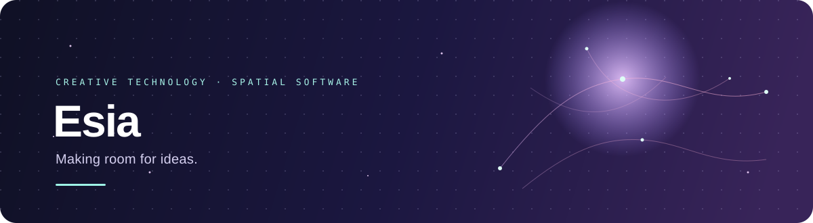
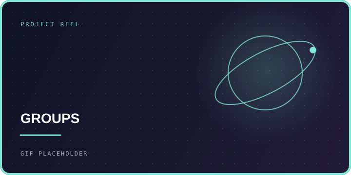
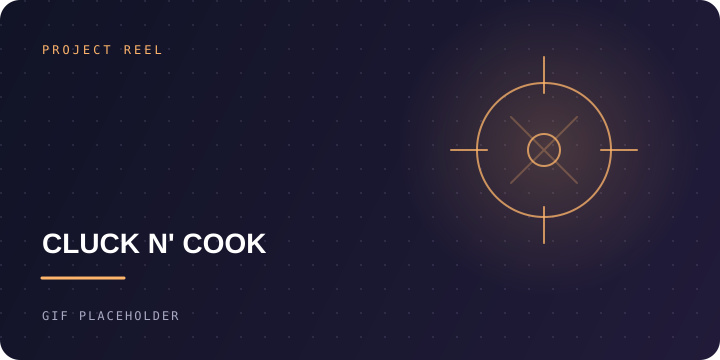
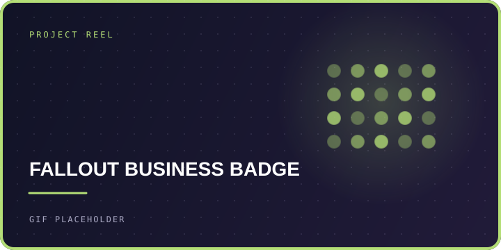
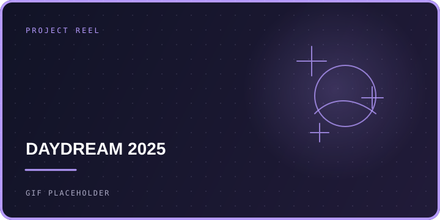
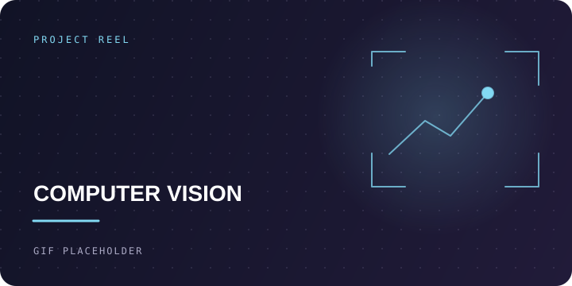
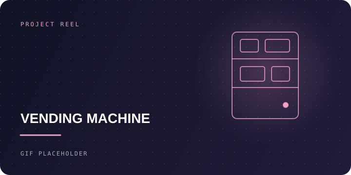

### I build tools that give ideas room to grow.

I’m **Esia** — exploring the space where thoughtful software, creative technology, and human connection meet.

&nbsp; 

---

## Project reel

<table>
  <tr>
    <td colspan="2" width="66%"></td>
    <td width="34%"></td>
  </tr>
  <tr>
    <td width="33%"></td>
    <td width="33%"></td>
    <td width="34%"></td>
  </tr>
  <tr>
    <td width="33%"></td>
    <td colspan="2" width="67%"></td>
  </tr>
</table>

Project tiles marked “GIF PLACEHOLDER” are ready for real clips as you capture them.

---

## What I’m making

### ◉ [Groups](https://github.com/flushloll/groups.) · spatial conversations

A shared 3D world where friends talk, explore as avatars, and shape rooms together with Luna, the built-in AI assistant.

`React Three Fiber` &nbsp; `TypeScript` &nbsp; `Rapier` &nbsp; `Node.js` &nbsp; `PostgreSQL`

## Selected projects

<!-- Add a project by duplicating a row. Keep the description to one clear sentence. -->

| Project | What it does | Built with |
|:--|:--|:--|
| [Groups](https://github.com/flushloll/groups.) | A shared 3D world where people talk, explore, and create with an AI assistant. | `React Three Fiber` · `TypeScript` · `Rapier` |
| [MIST](https://github.com/flushloll/MIST) | A rice-cooker robot with legs, documented with build notes and a hackathon zine. | `Go` · `Raspberry Pi` |
| [Cluck N' Cook](https://github.com/flushloll/Cluck-N-Cook) | A wave-based cartoon action shooter made for the Shiba Arcade game jam. | `Godot` · `GDScript` |
| [Fallout Business Badge](https://github.com/flushloll/fallout_business_badge) | A hackathon badge prototype with 36 NeoPixels, two buttons, and a custom PCB. | `ESP32-C3` · `NeoPixel` · `KiCad` |
| [Daydream 2025](https://github.com/flushloll/Daydream-2025-new) ([earlier version](https://github.com/flushloll/Daydream-2025)) | A Godot game prototype built for Daydream 2025. | `Godot` · `GDScript` |
| [Computer Vision Experiments](https://github.com/flushloll/computer_vision_experiments) | Detects a sheet of paper in a photo and corrects its perspective. | `Python` · `OpenCV` |
| [Vending Machine](https://github.com/flushloll/vendingMachine) | A fundraising vending-machine project, with a focus on microcontroller firmware. | `Embedded` |

## Current toolkit

  
  
  
  
  

*Good software makes complex things feel like an invitation.*

