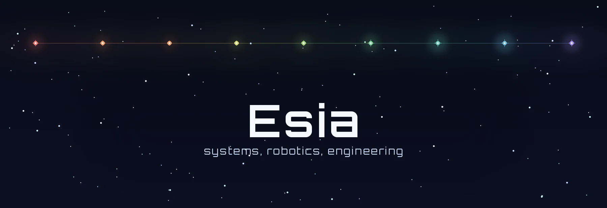
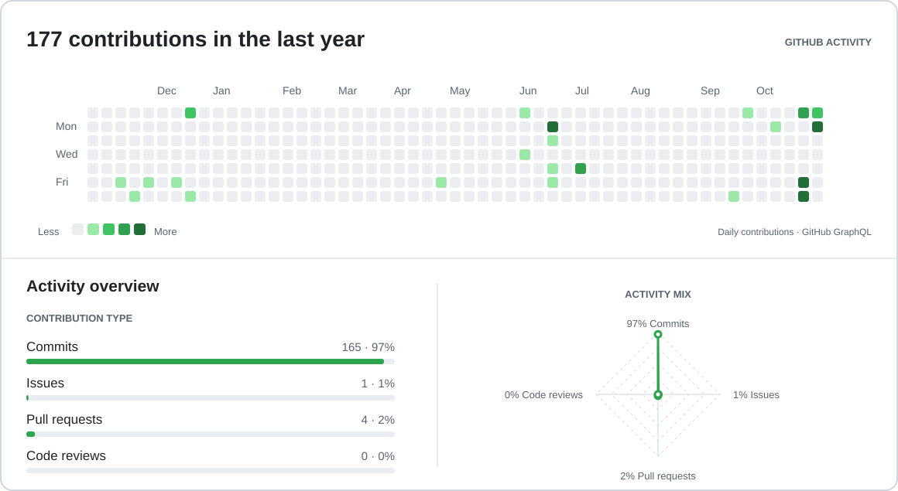

---

## Project reel

<table>
  <tr>
    <td width="33%"></td>
    <td width="33%"></td>
    <td width="34%"></td>
  </tr>
  <tr>
    <td width="33%"></td>
    <td width="33%"></td>
    <td width="34%"></td>
  </tr>
  <tr>
    <td width="33%"></td>
    <td width="33%"></td>
    <td width="34%"></td>
  </tr>
</table>

---

## Selected projects

<table>
  <tr>
    <td width="50%" valign="top">
      
      
A rice cooker that learned to walk.

    </td>
    <td width="50%" valign="top">
      
      
Shared 3D worlds shaped through conversation.

    </td>
  </tr>
  <tr>
    <td width="50%" valign="top">
      
      
Math becomes a multiplayer card game.

    </td>
    <td width="50%" valign="top">
      
      
Presentations assembled live from your speech.

    </td>
  </tr>
  <tr>
    <td width="50%" valign="top">
      
      
An ESP32 badge built for hackers.

    </td>
    <td width="50%" valign="top">
      
      
A frantic, chicken-filled arcade shooter.

    </td>
  </tr>
</table>

  
<b>More builds and experiments</b>

- [Soup Hopper](https://github.com/umarbektokyo/soup-hopper) — A can-bodied robot prototype.
- [Computer Vision Experiments](https://github.com/flushloll/computer_vision_experiments) — Exploring perception with OpenCV.
- [Daydream 2025](https://github.com/flushloll/Daydream-2025-new) — An experimental Godot game.

## Open source contributions

| Upstream project | Contribution |
|:--:|:--|
|  | [Update Hermes v3 kits to v0.22.5](https://github.com/docker/sbx-kits-contrib/pull/422) [Integrate host-managed Codex OAuth for Hermes](https://github.com/docker/sbx-kits-contrib/pull/423) |
|  | [Report misleading Codex quota/login error](https://github.com/NousResearch/hermes-agent/issues/145351) |

### GitHub activity overview

  <picture>
    <source media="(prefers-color-scheme: dark)" srcset="./assets/contributions/activity-dark.svg" />
    <source media="(prefers-color-scheme: light)" srcset="./assets/contributions/activity-light.svg" />
    
  </picture>

Updated daily from GitHub's contribution data. Counts reflect the activity visible to the workflow token.

## Current toolkit

  
  
  
  
  

## CAD & 3D design

  
  
  
  
  
  
  

*Good software makes complex things feel like an invitation.*

